<p align="center">
  
</p>

<p align="center">
  
  
  
  
  
</p>

<p align="center"><b>Shri Tools</b> is an app by <b>Shri Labs</b>.</p>

<p align="center"><b>Make talking AI cartoon and cinematic episodes - and music videos - on an ordinary gaming laptop (4 GB GPU), fully offline.</b></p>

You type an idea. Shri Tools writes the story, draws every scene with the same characters, makes each scene move,
talk and sing, **checks its own work** and makes the bad parts again, then gives you the finished video, three
Shorts, thumbnails and YouTube texts. No account, no upload, no API costs.

<table>
  <tr>
    <td width="33%">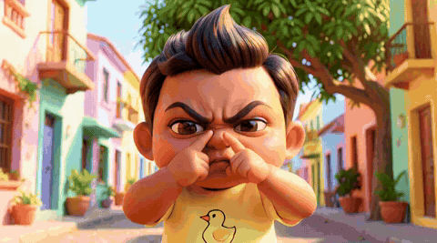<br><sub>🎬 <b>Thank You, Ramu Kaka</b> - the hook</sub></td>
    <td width="33%">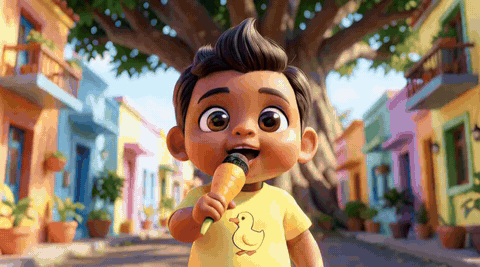<br><sub>🎵 <b>Thank You Bolo!</b> - Hindi song, lip-synced</sub></td>
    <td width="33%">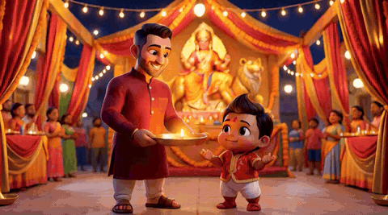<br><sub>🪔 <b>Jai Mata Di - Garba Night</b></sub></td>
  </tr>
  <tr>
    <td>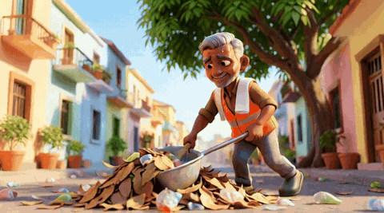<br><sub>🎬 Ramu Kaka at work</sub></td>
    <td>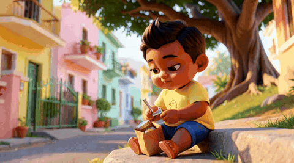<br><sub>🎬 <b>Thank You, Postman Uncle!</b></sub></td>
    <td>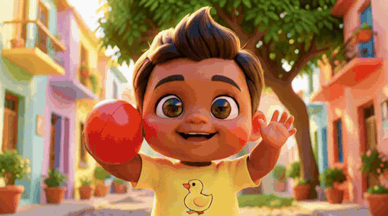<br><sub>🎬 "Respect everyone!"</sub></td>
  </tr>
</table>

> 🔊 GIFs have no sound. Watch the example episode **with voices**: [example_episode.mp4](docs/media/example_episode.mp4)
> (88 s, made entirely on the laptop below) and its [9:16 Short](docs/media/example_short.mp4).

## 🚀 Start in 5 steps

**What you need:** a Windows 11 laptop or PC with an NVIDIA graphics card (4 GB or more), 24 GB RAM and about
70 GB of free disk space.

1. Install [ComfyUI portable for Windows (NVIDIA)](https://github.com/comfyanonymous/ComfyUI/releases), the
   [ComfyUI-GGUF](https://github.com/city96/ComfyUI-GGUF) custom node, [Ollama](https://ollama.com) and
   [FFmpeg](https://www.gyan.dev/ffmpeg/builds/).
2. Copy `config.example.json` to `config.json` and set the paths.
3. Download the models and check everything:
   `<ComfyUI>\python_embeded\python.exe setup\check_setup.py --download`
4. `ollama pull gpt-oss:20b` (writes the stories) and `ollama pull qwen2.5vl:7b` (checks the pictures)
5. Double-click **Shri Tools.bat**. The app opens at http://127.0.0.1:7880.

Every step explained, with all model links: [docs/SETUP.md](docs/SETUP.md). How to use the app:
[docs/USER_GUIDE.md](docs/USER_GUIDE.md).

## ✨ What you can make

- 🎬 **Episodes** - 3D animated cartoons or cinematic stories where your characters act and talk, with the same faces
  in every scene. Make a whole season.
- 🎵 **Music videos** - a full song (Bollywood, folk, devotional, kids, pop, rap and more) that your characters sing
  with lip sync, duets included ([docs/MUSIC_VIDEOS.md](docs/MUSIC_VIDEOS.md)).
- 🗣️ **12 languages** - English, Hindi, Kannada, Konkani, Marathi, Tamil, Telugu, Malayalam, Bengali, Gujarati,
  Punjabi and Urdu. One click makes the same episode in another language ([docs/LANGUAGES.md](docs/LANGUAGES.md)).
- 📱 **Ready for YouTube** - three 9:16 Shorts per video, three thumbnails, titles, description, tags and subtitles.
- 🔍 **It checks its own work** - wrong pictures are drawn again, bad clips are made again (see below).
- 🤖 **It can run by itself** - schedules ("a new episode every Monday"), a Telegram bot for your phone, and an API
  with a ready [n8n](https://n8n.io) workflow ([docs/CONNECT_API.md](docs/CONNECT_API.md)).

## 🎨 Made with Shri Tools

Every picture below was drawn on the 4 GB laptop - episodes about respecting every job, a song about saying thank
you, a Navratri garba night and a Diwali song:

<table>
  <tr>
    <td>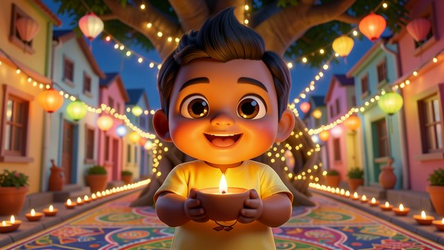<br><sub>🪔 Sabke Saath Diwali!</sub></td>
    <td>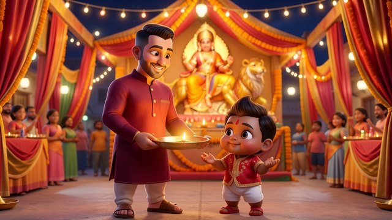<br><sub>🪔 Garba Night - aarti</sub></td>
    <td><br><sub>🎵 Thank You Bolo!</sub></td>
  </tr>
  <tr>
    <td>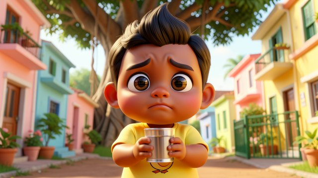<br><sub>🎬 Postman Uncle - cold water</sub></td>
    <td>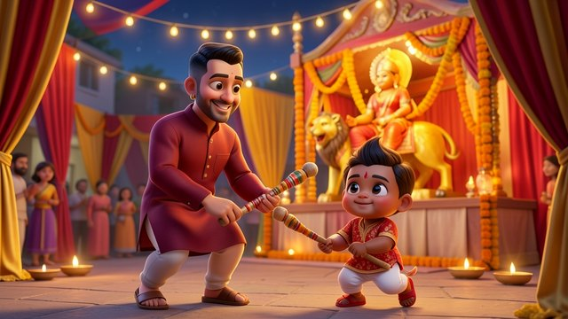<br><sub>🪔 Garba Night - dandiya</sub></td>
    <td>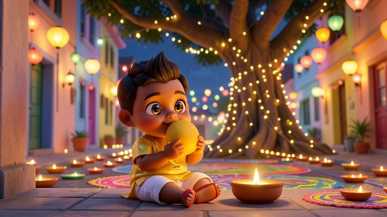<br><sub>🪔 Diwali laddoo</sub></td>
  </tr>
  <tr>
    <td>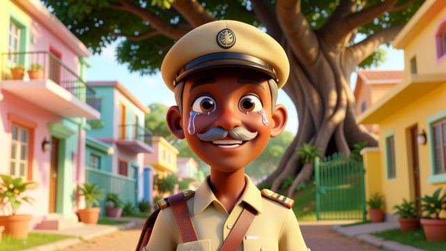<br><sub>🎬 Postman Raghu's happy tears</sub></td>
    <td>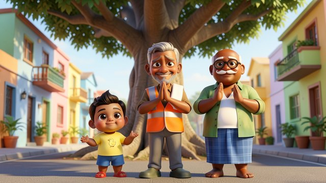<br><sub>🎵 Namaste, everyone</sub></td>
    <td>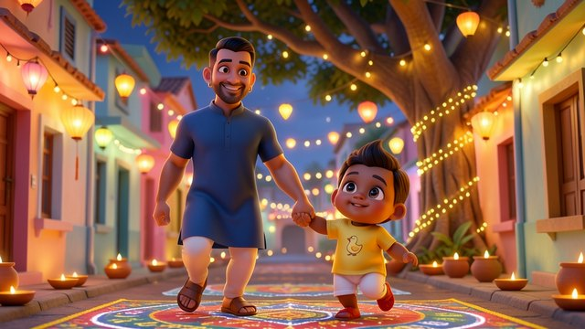<br><sub>🪔 Dancing in the lights</sub></td>
  </tr>
</table>

## 🔍 It checks its own work

AI pictures and videos make mistakes: a second copy of a character, a stranger in the background, a silent clip, a
mumbled line. Shri Tools looks at everything it makes, so you don't have to - even when videos are made
automatically at night:

<p align="center">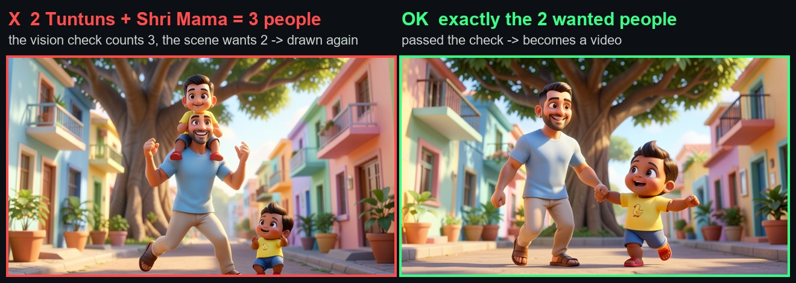</p>

| Check | What it catches | Then |
|---|---|---|
| 🖼️ **Pictures** | more people than the scene asks for, people in an empty shot, a clearly different action | drawn again |
| 👂 **Sound and words** | a wrong or unclear line, the wrong language, invented talking, silence | made again |
| 👀 **Videos** | a person who walked into the shot | made again |
| 🎵 **Songs** | finds your lyrics in the song; a woman's voice is sung by a woman, a man's by a man | right words, right singer |

## 🧩 How it works

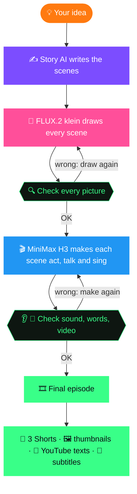

An episode of about 1.5 minutes takes roughly **4 hours** on a 4 GB laptop - start it before bed, watch it in the
morning.

<p align="center">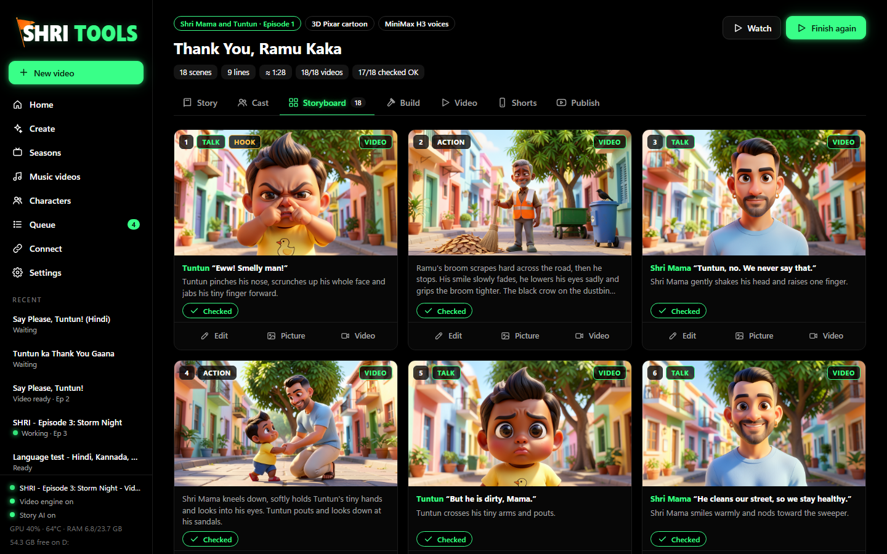</p>

## 💡 Good to know

- **Voices come from the video model itself**, so lips and voice always match. A character's voice can differ a
  little between scenes.
- **Every shot is 5 seconds on purpose.** Longer AI clips drift (faces change, lips slip), so longer scenes are cut
  into shots.
- **Quality:** a 4 GB laptop is not a cinema render farm, but it is good enough for kids' stories and YouTube Shorts.
- **Say that your videos are AI-made** (Shri Tools adds a note to every description), and only make characters from
  real people's photos with their permission.

<details>
<summary><b>🔧 For the curious: models, timings, the tested laptop, all features</b></summary>

### Models and timings (4 GB RTX 3050 laptop)

| Step | Model / tool | Time |
|---|---|---|
| Story (scenes, lines, hook) | a local LLM in [Ollama](https://ollama.com) (`gpt-oss:20b`), or Claude / ChatGPT / Gemini | 5-15 min (cloud: under a minute) |
| Character sheets + scene pictures | FLUX.2 [klein] 4B (character pictures as references) | 25-60 s per picture |
| Picture and video check | a vision model in Ollama (`qwen2.5vl:7b`), or the cloud story AI | about 1 min per picture |
| Acting clips with voices and sounds | MiniMax H3 (GGUF Q3, 4-step LoRA), 864x480, 5.2 s | 8-12 min per scene |
| Songs | MiniMax Music 3 (int8, low-VRAM) | about 30 min for 90 s |
| Sound and words check | Whisper (base.en, base, small) | ~1 min per round |
| Final episode | FFmpeg (crossfades, levelled sound) | 1 min |
| YouTube kit + 3 Shorts | LLM + FLUX.2 klein + FFmpeg | 5-8 min |

### Tested on (a budget gaming laptop)

| Part | Spec |
|---|---|
| CPU | Intel Core i5-12450H (8 cores) |
| GPU | NVIDIA GeForce RTX 3050 Laptop GPU, **4 GB VRAM** |
| RAM | 24 GB DDR4 (8 + 16 GB). With 8 GB, H3 crashed at 864x480 |
| OS | Windows 11 Home |
| Disk | about 63 GB for the models (12 GB of them for music videos), about 2 GB per finished episode |

ComfyUI runs memory-safe (`--disable-smart-memory --cache-none`) and Shri Tools restarts it between the picture model
and the video model, which is what makes H3 fit next to everything else on this hardware.

### All features

- **Seasons and characters**: one style and one cast per season; every character gets a full-body and a face picture
  (from a description, from photos, or your own drawing) used as a reference in every scene. A video can give a
  character its own costume (a night episode without sunglasses, a festival kurta).
- **Storyboard editor**: every scene has a picture, a talk or action type, a line, sounds and a camera move. Redraw one
  picture or remake one video take without touching the rest.
- **H3 prompt rules built in** (learned the hard way, see [docs/HOW_IT_WORKS.md](docs/HOW_IT_WORKS.md)): one speaker per
  close-up, short lines, only sounds whose source is in the picture, never "silence", no unnamed crowds.
- **Music videos**: lyrics by the story AI or by you; your real lyrics are found on the song's timeline, so every
  close-up sings the right words and the subtitles follow the song; the voice in each shot picks a man or a woman of
  the cast; close-ups only where there is singing, story shots in between.
- **Same episode, another language**: all pictures and action scenes are reused, only the talking scenes are made
  again (about half the time).
- **Three Shorts**: the hook and the climax, the opening story, the strongest moment (songs: the main Short, the
  chorus, the ending).
- **Next-episode ideas**: one click on a season gives 10 fresh ideas in the series' tone.
- **Automations**: "every Mon/Wed/Fri at 22:00 make the next episode", "make the newest episode in Hindi too", or start
  any job at a set time.
- **Telegram bot** (your own, optional): alerts and `/status`, `/videos`, `/approve N`, `/pictures N`, `/short N`,
  `/make idea`. No tunnel needed.
- **Choose your story AI**: Ollama (free, offline, the default) or Claude, ChatGPT, Gemini or any OpenAI-compatible
  service. Pictures, videos and voices always stay on the laptop.
- **Live laptop monitor**: GPU load, temperature and memory, RAM, CPU, disk.
- **One GPU job at a time** in a queue that survives restarts and power cuts.
- **Optional logo in videos**: a waving-flag intro, a corner logo and an end card (off by default).

<p align="center">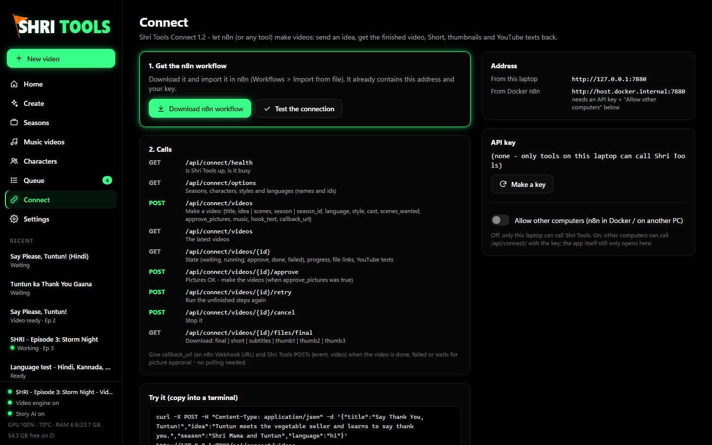</p>

### What is in this repository

```
studio/      server.py (app + API, port 7880), connect.py (n8n API), worker.py, produce.py (all steps),
             writer.py (story + YouTube texts), picqc.py (vision check), lyrics.py (lyrics on the timeline),
             musicvideo.py (songs), store.py (library on disk), web/ (the app: plain HTML/JS/CSS)
engine/      talk_clip.py (H3 graph, ComfyUI start/stop), scene_qc.py (sound + words check), assemble.py (join),
             music.py (optional MusicGen)
setup/       check_setup.py (checks + downloads), comfyui-gguf-h3.patch (lets ComfyUI-GGUF load the H3 GGUF)
n8n/         shritub_connect_workflow.json (import into n8n), make_connect_workflow.py
library/     your characters, seasons and videos (created on first start, not in git)
output/      every finished episode is also copied here
```

</details>

## 📰 What's new

- **[2026-10-15]** 🔥 **First public release**: episodes and music videos, 12 languages, automatic checks, three
  Shorts per video, schedules, Telegram and n8n.
- **Coming next:** 📤 upload to YouTube (video, Shorts, thumbnail, subtitles) and 📸 Instagram / Facebook Reels.

## 📜 Licenses and credits

Shri Tools's own code is MIT licensed (see [LICENSE](LICENSE)). The models are not part of this repository and keep
their own licenses; read them before you publish or monetize videos:

- MiniMax H3: [MiniMax H3 Community License](https://huggingface.co/MiniMaxAI/MiniMax-H3/blob/main/LICENSE)
  (GGUF by [unsloth](https://huggingface.co/unsloth/MiniMax-H3-GGUF), text encoder GGUF by
  [realrebelai](https://huggingface.co/realrebelai/MiniMax-H3_GGUFs), 4-step LoRA by
  [Kijai / lightx2v](https://huggingface.co/Kijai/MiniMax-H3_comfy), VAEs by [Comfy-Org](https://huggingface.co/Comfy-Org/MiniMax-H3))
- MiniMax Music 3: [MiniMax-Music3 Community License](https://huggingface.co/MiniMaxAI/MiniMax-Music3/blob/main/LICENSE)
  (ComfyUI files by [Comfy-Org](https://huggingface.co/Comfy-Org/MiniMax-Music-3))
- FLUX.2 [klein] 4B: Apache-2.0, [black-forest-labs](https://huggingface.co/black-forest-labs/FLUX.2-klein-4b-fp8)
- Qwen2.5-VL 7B (picture and video check): see its [model card and license](https://huggingface.co/Qwen/Qwen2.5-VL-7B-Instruct), used through [Ollama](https://ollama.com/library/qwen2.5vl)
- Whisper: MIT, [OpenAI](https://huggingface.co/openai)
- [ComfyUI](https://github.com/comfyanonymous/ComfyUI) (GPL-3.0), [ComfyUI-GGUF](https://github.com/city96/ComfyUI-GGUF)
  (Apache-2.0), [Ollama](https://ollama.com), [FFmpeg](https://ffmpeg.org)

## ⭐ Like it?

If Shri Tools helps you make something, a ⭐ star helps other people find it.

<p align="center"><sub><b>Shri Tools</b> by <b>Shri Labs</b> · Made with ❤️ in India, on a 4 GB laptop.</sub></p>
