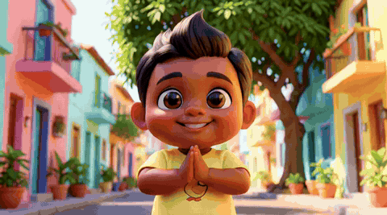

# Shri Tools

**Make talking AI cartoon and cinematic episodes on an ordinary gaming laptop (4 GB GPU), fully offline.**

You type an idea. Shri Tools writes the story, draws every scene with the same characters, makes each scene move and
talk with **MiniMax H3** (picture, voice, lip sync and sound effects in one model), checks every clip with Whisper,
remakes the bad ones, joins the final episode and prepares a YouTube kit: titles, description, tags, thumbnails,
subtitles and a 9:16 Short.

<p align="center">
  
  
</p>
<p align="center">
  
  
</p>

> GIFs have no sound. Watch the full example episode **with voices**:
> [docs/media/example_episode.mp4](docs/media/example_episode.mp4) (88 s, made entirely on the laptop below) and its
> [9:16 Short](docs/media/example_short.mp4). All 18 scene pictures: [storyboard.jpg](docs/media/storyboard.jpg).

## What it makes

| Step | Model / tool | On a 4 GB RTX 3050 laptop |
|---|---|---|
| Story (scenes, lines, hook) | a local LLM in [Ollama](https://ollama.com) (`gpt-oss:20b`), or Claude / ChatGPT / Gemini | 5-15 min (cloud: under a minute) |
| Character sheets + scene pictures | FLUX.2 [klein] 4B (character pictures as references) | 25-60 s per picture |
| Acting clips with voices and sounds | MiniMax H3 (GGUF Q3, 4-step LoRA), 864x480, 5.2 s | 8-12 min per scene |
| Songs for music videos | MiniMax Music 3 (int8, low-VRAM) | depends on length |
| Quality check + automatic remakes | Whisper (base.en, base, small) | ~1 min per round |
| Final episode | FFmpeg (crossfades, levelled sound) | 1 min |
| YouTube kit | LLM + FLUX.2 klein + FFmpeg | 3-5 min |

An 18-scene episode (about 1.5 minutes) takes roughly **4 hours**, unattended. Everything runs locally: no account,
no upload, no API costs.

## Tested on (a budget gaming laptop)

| Part | Spec |
|---|---|
| CPU | Intel Core i5-12450H (8 cores) |
| GPU | NVIDIA GeForce RTX 3050 Laptop GPU, **4 GB VRAM** |
| RAM | 24 GB DDR4 (8 + 16 GB). With 8 GB, H3 crashed at 864x480 |
| OS | Windows 11 Home |
| Disk | about 57 GB for the models (12 GB of them for music videos), about 2 GB per finished episode |

ComfyUI runs memory-safe (`--disable-smart-memory --cache-none`) and Shri Tools restarts it between the picture model
and the video model, which is what makes H3 fit next to everything else on this hardware.

## Features

- **Seasons and characters**: one style and one cast per season; every character gets a full-body and a face
  picture (from a description, from photos, or your own drawing) that is used as a reference in every scene, so faces
  stay the same. A video can give a character its own costume (for example a night episode without sunglasses).
- **Storyboard editor**: every scene has a picture, a talk or action type, a line, sounds and a camera move. Redraw one
  picture or remake one video take without touching the rest.
- **H3 prompt rules built in** (learned the hard way, see [docs/HOW_IT_WORKS.md](docs/HOW_IT_WORKS.md)): one speaker per
  close-up, short lines, only sounds whose source is in the picture, never "silence", no unnamed crowds.
- **Quality gate**: the right words, the right language, no invented talking, not silent. Failed clips are made again
  with a new seed, every try is kept and the best one wins.
- **Hook + Short**: scene 1 is always a hook; the 9:16 Short starts with it and adds the strongest run of scenes.
- **YouTube kit**: 3 titles, description with an AI note, tags, hashtags, 3 thumbnails, `.srt` subtitles.
- **Music videos**: a song in any of the languages below with **MiniMax Music 3** (lyrics written by the story AI
  or by you; Bollywood, folk, devotional, kids' rhymes, pop, rap, lo-fi, EDM and more), then your characters sing it
  with H3 lip sync, cut exactly on the song (see [docs/MUSIC_VIDEOS.md](docs/MUSIC_VIDEOS.md)).
- **Indian languages**: English, Hindi, Kannada, Konkani, Marathi, Tamil, Telugu, Malayalam, Bengali, Gujarati, Punjabi
  and Urdu: lines in their own script, English meaning in the subtitles, captions drawn with proper script shaping
  (see [docs/LANGUAGES.md](docs/LANGUAGES.md)).
- **Same episode, another language**: one click makes a dubbed copy: all pictures and action scenes are reused, the
  story AI translates the lines and only the talking scenes are made again (about half the time).
- **Telegram bot** (your own, optional): alerts when a video is ready or its pictures wait for you (with the pictures),
  and commands from your phone: `/status`, `/videos`, `/approve N`, `/pictures N`, `/short N`, `/make idea`. No tunnel
  needed: Shri Tools polls Telegram itself and only answers your chat.
- **Choose your story AI**: Ollama on the laptop (free, offline, the default) or a cloud model - Claude (Anthropic),
  ChatGPT (OpenAI), Gemini (Google) or any OpenAI-compatible service (OpenRouter, Groq, DeepSeek, LM Studio). Only the
  text writing changes; pictures, videos and voices always stay on the laptop.
- **Automations and start times**: "every Mon/Wed/Fri at 22:00 make the next episode of this season" (fully automatic
  or stopping at the pictures for you), "make the newest episode in Hindi too", or start any queued job at a set time.
- **Next-episode ideas**: one click on a season gives 10 fresh ideas in the series' tone; *Make this episode* fills
  the Create form.
- **Live laptop monitor** on the Queue page: GPU load, temperature and memory, RAM, memory commit, CPU, disk.
- **Optional logo in videos**: a waving-flag intro, a corner logo and an end card (off by default).
- **Shri Tools Connect**: a small HTTP API and a ready n8n workflow: send an idea, get the finished video, Short and
  YouTube texts back (see [docs/CONNECT_API.md](docs/CONNECT_API.md)).
- **One GPU job at a time** in a queue that survives restarts and power cuts (each step skips finished work).

<p align="center"></p>
<p align="center"></p>

## Quick start

1. Install [ComfyUI portable for Windows (NVIDIA)](https://github.com/comfyanonymous/ComfyUI/releases), the
   [ComfyUI-GGUF](https://github.com/city96/ComfyUI-GGUF) custom node, [Ollama](https://ollama.com) and
   [FFmpeg](https://www.gyan.dev/ffmpeg/builds/).
2. Copy `config.example.json` to `config.json` and set the paths.
3. Download the models and check everything:
   `<ComfyUI>\python_embeded\python.exe setup\check_setup.py --download`
4. `ollama pull gpt-oss:20b`
5. Double-click **Shri Tools.bat**. The app opens at http://127.0.0.1:7880.

Step by step, with every model link: [docs/SETUP.md](docs/SETUP.md). Using the app: [docs/USER_GUIDE.md](docs/USER_GUIDE.md).

## How it fits together

```
idea ──► story AI (Ollama) ──► scenes ──► FLUX.2 klein pictures ──► MiniMax H3 clips ──► Whisper check ──┐
                                   ▲                                    (voice + lip sync + sound)        │
                       character pictures                                                remake bad ones ◄┘
                                                                                                │
             YouTube kit (titles, thumbnails, srt, 9:16 Short) ◄── FFmpeg join (crossfades) ◄───┘
```

```
studio/      server.py (app + API, port 7880), connect.py (n8n API), worker.py, produce.py (all steps),
             writer.py (story + YouTube texts), store.py (library on disk), web/ (the app: plain HTML/JS/CSS)
engine/      talk_clip.py (H3 graph, ComfyUI start/stop), scene_qc.py (quality gate), assemble.py (join),
             music.py (optional MusicGen)
setup/       check_setup.py (checks + downloads), comfyui-gguf-h3.patch (lets ComfyUI-GGUF load the H3 GGUF)
n8n/         shritub_connect_workflow.json (import into n8n), make_connect_workflow.py
library/     your characters, seasons and videos (created on first start, not in git)
output/      every finished episode is also copied here
```

## Good to know

- **Speech is H3's own audio.** No separate text-to-speech: H3 generates the voice together with the picture, so lips
  and voice match. The price: voices of the same character can differ a little between scenes.
- **Slow but unattended.** Queue an episode before bed, watch it in the morning.
- **Quality ceiling.** A quantized model at 864x480 and 4 steps on a 4 GB GPU is not a cinema render; it is good enough
  for kids' stories and YouTube Shorts, and gets better with each prompt rule.

## Licenses and credits

Shri Tools's own code is MIT licensed (see [LICENSE](LICENSE)). The models are not part of this repository and keep
their own licenses; read them before you publish or monetize videos:

- MiniMax H3: [MiniMax H3 Community License](https://huggingface.co/MiniMaxAI/MiniMax-H3/blob/main/LICENSE)
  (GGUF by [unsloth](https://huggingface.co/unsloth/MiniMax-H3-GGUF), text encoder GGUF by
  [realrebelai](https://huggingface.co/realrebelai/MiniMax-H3_GGUFs), 4-step LoRA by
  [Kijai / lightx2v](https://huggingface.co/Kijai/MiniMax-H3_comfy), VAEs by [Comfy-Org](https://huggingface.co/Comfy-Org/MiniMax-H3))
- MiniMax Music 3: [MiniMax-Music3 Community License](https://huggingface.co/MiniMaxAI/MiniMax-Music3/blob/main/LICENSE)
  (ComfyUI files by [Comfy-Org](https://huggingface.co/Comfy-Org/MiniMax-Music-3))
- FLUX.2 [klein] 4B: Apache-2.0, [black-forest-labs](https://huggingface.co/black-forest-labs/FLUX.2-klein-4b-fp8)
- Whisper: MIT, [OpenAI](https://huggingface.co/openai)
- [ComfyUI](https://github.com/comfyanonymous/ComfyUI) (GPL-3.0), [ComfyUI-GGUF](https://github.com/city96/ComfyUI-GGUF)
  (Apache-2.0), [Ollama](https://ollama.com), [FFmpeg](https://ffmpeg.org)

**Use it responsibly:** say that your videos are AI-made (Shri Tools adds a note to every description), and only make
characters from real people's photos with their permission.
